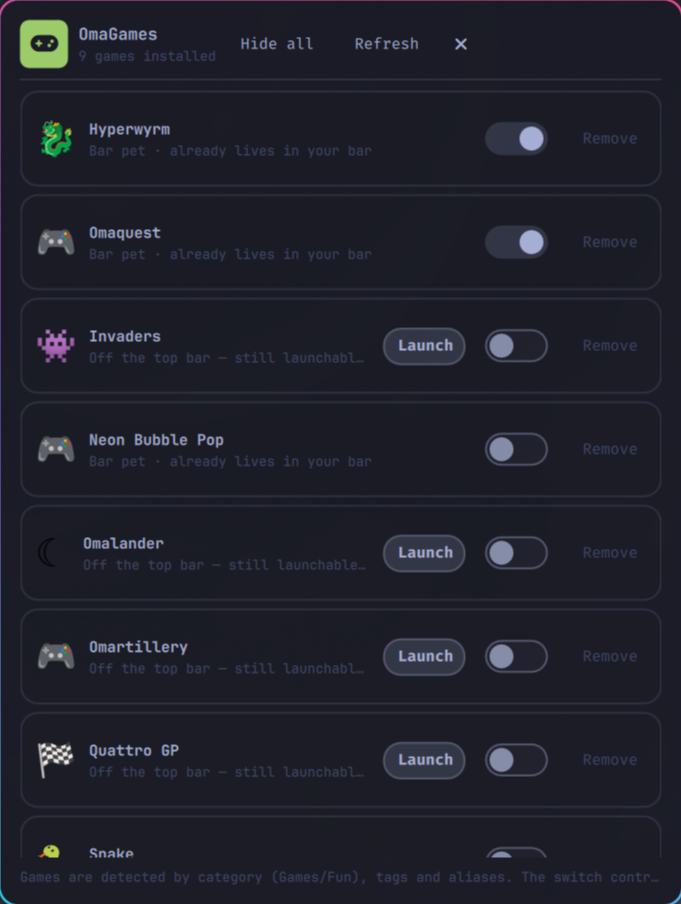

# OmaGames for [Omarchy](https://omarchy.org)

One bar icon for every game plugin you have installed. No more one-icon-per-game
in the top bar — click the gamepad, pick a game, play.



## Installation

```bash
omarchy plugin add https://github.com/davidsmorais/omarchy-omagames --enable
```

## How it works

The background service scans `~/.config/omarchy/plugins/*/manifest.json` every
minute (and every time the panel opens) and lists every plugin that looks like
a game:

- `barWidget.category` is `Games`, `Game`, `Fun`, `Arcade` or `Play`, **or**
- top-level `tags` contain `game` / `gaming` / `arcade` / `fun`, **or**
- `barWidget.aliases` contain `game` / `arcade`, **or**
- its ID is listed in the **Always include** setting.

Newly installed games appear automatically. Launching a game calls
`shell.toggle("<id>", "{}")` — the exact route that game's own bar icon uses —
with a CLI fallback (`omarchy-shell shell toggle <id>`).

## Bar widget

- Gamepad icon (``), accented when at least one game is installed
- Tooltip shows the detected game count
- Left click: open the launcher · Right click: toggle it

## Panel

- One row per game: glyph, name, short description, **Launch** button.
  Launching uses the shell IPC route (`omarchy-shell shell toggle <id>`,
  the command the games themselves document) — the scoped shell object a
  plugin receives cannot toggle other plugins' ids, so the panel never calls
  `shell.toggle(gameId)` directly
- **Show** on hidden games (enables the plugin, icon returns in its usual spot)
- **Hide** on visible games (icon leaves the top bar, widget disabled) —
  including the bar-pet row. A hidden game can't be opened until shown again:
  the shell refuses to summon disabled plugins
- **Hide all** / **Show all** in the header: one click to a single top-bar
  entry, actions queue and run one at a time behind the scenes
- Action feedback: the acting row reads **Working…** while the shell reloads
  (takes ~10 s), other rows lock, and a failed action shows an error instead
  of silently reverting. The list re-scans on its own until the shell reports
  the new state, and also picks up changes made elsewhere (omaplug,
  settings, terminal)
- Empty state points at example game plugins when none are detected

Note: for bar widgets, *enabled* and *in the top bar* are the same thing —
the shell defines one through the other — so Add/Remove is the enable/disable
switch, not a second one.

## Settings

| Key         | What it does                                              |
|-------------|-----------------------------------------------------------|
| `extraIds`  | Comma-separated plugin IDs to always list as games        |
| `hiddenIds` | Comma-separated plugin IDs to never list                  |

Example: `omarchy bar set david.omagames hiddenIds "dawestheperson.hyperwyrm"`

## Files

| File            | Purpose                                              |
|-----------------|------------------------------------------------------|
| `manifest.json` | Plugin manifest (service + bar-widget + panel)       |
| `Service.qml`   | Owns the game list, scanning, launch/enable actions  |
| `BarWidget.qml` | Single gamepad icon in the bar                       |
| `Panel.qml`     | Launcher window                                      |
| `scan-games.py` | Manifest scanner (also runnable by hand, see below)  |

Manual scan:

```sh
python3 ~/.config/omarchy/plugins/david.omagames/scan-games.py | python3 -m json.tool
```
